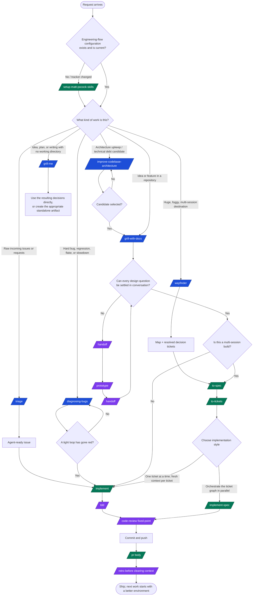

# Universal Skill Flow and Catalogue

> **Purpose:** choose the smallest complete process for a request, then know what
> every installed skill requires and produces.
>
> **Source of truth:** this is a navigation guide distilled from the actual
> `.agents/skills/*/SKILL.md` files in this repository. A skill's own `SKILL.md`
> wins if this guide and that source ever differ. The existing
> [`docs/ask-matt/README.md`](README.md) records a particular integrations run;
> it is not a replacement for the installed skill instructions.
>
> **Important:** there is no valid workflow that invokes every skill. The
> universal flow is a **router**: take one entry path, use supporting skills only
> when their condition is true, then return to the delivery flow.

## 1. The universal flow



### Read the diagram as rules, not ceremony

1. **Configure once, then maintain only when configuration changes.**
   `/setup-matt-pocock-skills` establishes the issue tracker, triage labels, and
   domain-document layout. In this repository it is already configured in
   `docs/agents/` and `AGENTS.md`.
2. **Route by uncertainty and size.** A scoped small change does not need a map
   or a spec. A large, unclear destination does not go straight to implementation.
3. **`/wayfinder` plans; it normally does not build.** Its output joins the
   delivery flow at `/to-spec`, not `/implement`.
4. **`/triage` is for work the project did not create.** Tickets published by
   `/to-tickets` are already `ready-for-agent`; do not triage them again.
5. **A hard bug starts with evidence, not a code theory.**
   `/diagnosing-bugs` does not permit hypotheses until a fast, deterministic,
   red-capable loop exists.
6. **The main planning thread stays intact.** Keep
   `/grill-with-docs → /to-spec → /to-tickets` in one context window. Start a
   fresh context for each independent `/implement` ticket.
7. **Delivery is complete only after learning.** `/retro` changes the agent
   environment—checks, navigation, standards, and tooling—not the feature code.

## 2. Complexity ladder: choose the entry point

| Level | Shape of work | Start here | Do not add |
| --- | --- | --- | --- |
| L0 | Trivial typo, one-line config, obvious mechanical correction | Make the smallest safe edit and verify it | A planning flow solely for ceremony |
| L1 | A broken behavior with a narrow, reproducible scope | `/diagnosing-bugs` when it needs diagnosis; otherwise test-first `/implement` | `/wayfinder` or a full ticket graph |
| L2 | Clear feature that fits one focused session | `/implement` in the current planning context | `/to-spec` and `/to-tickets` unless it genuinely becomes multi-session |
| L3 | Clear feature or refactor spanning several fresh implementation sessions | `/grill-with-docs → /to-spec → /to-tickets` | `/wayfinder` when the route is already visible |
| L4 | Huge, uncertain destination whose decisions cannot fit one session | `/wayfinder → /to-spec → /to-tickets` | Implementation before the decision map has collapsed into a spec |

## 3. Context and phase-boundary protocol

At a real phase boundary, use the first matching option below. Do not compact
by default.

```text
Does the next phase need this phase as its primary source?
  Yes → Continue in the same context.
  No  → Is everything disposable?
           Yes → /clear.
           No  → Does the next part need a new harness, directory, colleague,
                  or a mid-phase side fork?
                    Yes → /handoff.
                    No  → Is it tightly scoped work that can run unattended?
                             Yes → delegate a subagent.
                             No  → /compact at the boundary.
```

- A `/handoff` document is portable and belongs in the OS temporary directory;
  it points at issues, specs, ADRs, commits, and diffs instead of copying them.
- `/prototype` is a special handoff case because it lives in a different
  directory/branch and answers one runnable question.
- `/retro` belongs in the session being examined. Run it before `/clear`, or
  explicitly point it at a preserved session log.

## 4. Complete skills matrix

**Router relationship** distinguishes the Ask-Matt flow from other installed
specialists. “Outside router” does not mean unusable; it means `/ask-matt` does
not choose it as part of its core engineering flow.

| Skill | Router relationship | Use it when | Prerequisites / guardrails | Expected output and likely next step |
| --- | --- | --- | --- | --- |
| `/ask-matt` | **Router** | You know the situation but not the right skill or flow. | Read the actual target skill before explaining or skipping it. | A justified route; invoke the selected parent skill, not every child skill. |
| `/setup-matt-pocock-skills` | Engineering-flow foundation | First engineering flow in a repo, or when its tracker/doc layout changes. | Explore repo first; ask user to confirm tracker and label choices. Edit existing `CLAUDE.md` or `AGENTS.md`, never create a competing one. | Tracker, triage-label, and domain-doc configuration under `docs/agents/`; later engineering skills can use it. |
| `/grill-with-docs` | **Main-flow entry in a repo** | An idea, feature, design, or plan needs sharpening in a working directory. | A working directory; keep the planning thread alive. | Calls `/grilling` + `/domain-modeling`; resolved decisions in glossary/ADRs. Continue to prototype, `/implement`, or `/to-spec`. |
| `/grill-me` | Standalone entry | An idea, plan, or writing has no working directory to hold a paper trail. | No repository state is required. | Calls `/grilling`; a stateless set of decisions. Use directly or transfer to a suitable project flow. |
| `/grilling` | Underlying interview primitive | You explicitly need a rigorous decision interview without a wrapper. | User must be available for decisions; agent finds facts itself. | Rounds of frontier questions, each with a recommended answer; done only when the design-tree frontier is empty and understanding is confirmed. |
| `/domain-modeling` | Vocabulary layer | A domain term is fuzzy, overloaded, contradicted by code, or a hard-to-reverse domain decision lands. | Read current glossary/map and relevant ADRs. Create files lazily; an ADR needs a real, hard-to-reverse trade-off. | Updated `GLOSSARY.md` and, when warranted, an ADR. Resume the parent planning skill. |
| `/handoff` | Phase-boundary support | A fresh agent/session needs a new harness, directory, colleague handoff, or side-task fork. | Name what the next session will do; redact secrets; reference existing primary artifacts rather than copying them. | A portable temporary Markdown handoff with suggested skills. Start the new session from it. |
| `/claude-handoff` | Outside router; handoff automation | The next step should immediately run in a fresh Claude background agent. | Claude CLI/background-agent harness must be available; same redaction and pointer rules as `/handoff`. | Temporary handoff plus a named `claude --bg` agent; user manages it with `claude agents`. |
| `/prototype` | Main-flow design detour | A state model, business behavior, or UI cannot be settled on paper. | State one question; choose **logic** or **UI** prototype branch. Keep it clearly throwaway and easy to run. | A runnable, low-polish artifact and a recorded verdict. Preserve it on a prototype branch; hand its decision back to planning. |
| `/to-spec` | Multi-session planning | Conversation/map decisions are sufficient to synthesize a buildable spec. | Configured tracker + labels; no new interview; understand current repo and agree test seams with the user. | A published `ready-for-agent` spec: problem, solution, stories, implementation/testing decisions, scope. Next `/to-tickets`. |
| `/to-tickets` | Multi-session planning | A plan/spec must become independently implementable work. | Configured tracker + labels; read passed issue/spec; user approves ticket granularity and blocking edges. | `ready-for-agent` tracer-bullet tickets with blockers; work the unblocked frontier with `/implement` or `/implement-spec`. |
| `/implement` | Delivery, one ticket/scope at a time | A clear small request, approved spec, or one ready ticket is ready to build. | Fetch an explicit ticket reference; agree test seams; use TDD where possible. | Code, focused/full verification, code review, and a commit on the current branch. Then shape PR evidence. |
| `/implement-spec` | Delivery, task-graph orchestration | You prefer to orchestrate an approved spec’s tickets across parallel implementers. | Configured tracker; spec plus blocker graph; ability to create an integration branch/worktrees/subagents. | Entire graph on one integration branch, one final review, resolved tickets, and PR-ready branch. |
| `/tdd` | Underlying build discipline | A concrete behavior should be implemented or locked down test-first. | Read glossary/ADRs; **agree the public test seam with the user first**. | One vertical red → green slice at a time; behavior-level tests, not implementation-coupled tests. Review/refactor afterward. |
| `/code-review` | Delivery review | You need a review of a branch/PR/work-in-progress relative to a fixed point. | User supplies a resolving fixed point and non-empty diff; identify spec and documented standards. | Separate Standards and Spec reports from parallel review axes. Address relevant findings before PR. |
| `/pr` | Delivery communication | Writing the pull-request body. | Change and evidence already exist. | Concise PR body with a visual summary, before/after evidence, door type, and blast radius. |
| `/retro` | Delivery learning loop | After a build—especially a difficult one—before context is cleared. | Read this session’s primary artifacts/log; inspect existing repo checks before suggesting more. | Ranked improvements to the agent environment: navigation, deterministic checks, review standards, tooling, or information access. |
| `/triage` | On-ramp for incoming work | Raw issues, incoming requests, or configured external PRs need classification. | Configured tracker + label mapping; every tracker comment starts with the AI-triage disclaimer. Verify claims before grilling. | One category (`bug`/`enhancement`) + one state label and an agent/human brief, needs-info note, or wontfix outcome. `ready-for-agent` flows to `/implement`. |
| `/diagnosing-bugs` | Bug on-ramp | A bug, regression, flake, failure, or performance issue resists a first glance. | Read glossary/ADRs; redact secrets. **Do not hypothesize before a tight, red-capable, deterministic, fast loop exists.** | Minimal repro, ranked falsifiable hypotheses, probes, regression test, fix, cleanup. Then `/retro`; architectural seam failures feed `/improve-codebase-architecture`. |
| `/wayfinder` | Foggy-large-work on-ramp | Destination is larger than one session and the route to it is unclear. | Configured tracker; a named destination; work one decision ticket/session except research. | A `wayfinder:map` issue, decision tickets, and resolved decision pointers. When fog clears, go to `/to-spec`, not direct implementation. |
| `/improve-codebase-architecture` | Codebase-health on-ramp | You have spare capacity to find high-leverage technical-debt/deepening candidates. | Read glossary and relevant ADRs; scope scan to recent hot spots or user’s area; use `/codebase-design` vocabulary. | Self-contained temporary HTML report with before/after candidates. User picks one; then grill it and enter main flow. |
| `/codebase-design` | Architecture vocabulary layer | The question is module shape, depth, seam placement, adapters, testability, or alternative interfaces. | A concrete module/design problem; do not introduce a seam merely for one adapter. | Shared vocabulary and design constraints; supports TDD and architecture work rather than replacing their flow. |
| `/research` | Standalone / Wayfinder support | Primary-source reading or documentation/API fact-finding can proceed in background. | A specific research question; use high-trust primary sources; match repo note convention. | One cited Markdown research file. Feed findings into grilling, wayfinding, or a spec. |
| `/to-questionnaire` | Standalone support | The blocker is knowledge held by another person. | Identify recipient/relationship and exact decisions or facts needed back. | `to-questionnaire-<slug>.md`, ordered and gap-focused. Use returned answers in grilling or `/to-spec`. |
| `/wizard` | Human-in-the-loop support | A human must provision infrastructure, configure credentials/secrets, use an external dashboard, or execute a one-off migration/cutover. | Read repo config/CI first; user confirms ordered stages and secret destinations; never invent UI steps. | Tested, executable staged bash wizard. It is ephemeral unless the user wants a repeatable committed procedure. |
| `/wait-what` | Conversation repair | The last explanation did not land. | A preceding message exists; consult glossary language if present. | A simplified re-pitch with missing context; return to the interrupted work. |
| `/teach` | Standalone learning system | User wants to learn a subject across multiple sessions in this workspace. | Establish a learner mission and trusted resources before relying on model knowledge. | Stateful teaching workspace: mission, sources, records, reusable assets, short interactive HTML lessons, and reference material. |
| `/writing-for-agents` | Documentation reference | Creating/editing skills, `AGENTS.md`, `CLAUDE.md`, or agent-facing docs. | Identify whether content is an in-file step, reference, or a pointed-at document. | Guidance for low-context-load, single-source, branch-triggered agent instructions. |
| `/chief-of-staff` | Outside router; long-running coordination | One long session must pursue a goal through subagents and schedules. | Harness must permit background agents/schedules; maintain sparse context pointers. | Tactical execution plus strategic environment improvements; work delegated to subagents. |
| `/frontend-design` | Outside router; UI specialist | Building or reshaping UI needs an intentional, non-template visual direction. | Know or confirm product subject, audience, and page’s primary job; create/review a design plan before code. | Distinct design plan and implementation with deliberate typography, palette, layout, accessibility, and self-critique. |
| `/responsive-design` | Outside router; UI specialist | Building adaptive layouts, component responsiveness, responsive tables/media/navigation, or fluid scales. | A UI/layout to adapt; consult detailed patterns only when the navigation guidance is insufficient. | Mobile-first, content-breakpoint, container-query-aware layout with device/touch/performance checks. |
| `/tailwind-design-system` | Outside router; UI specialist | Building a Tailwind **v4** component library, tokens, themes, variants, or standardizing UI patterns. | Confirm Tailwind v4 or deliberately use its upgrade path; do not apply v4 config blindly to v3. | CSS-first tokens/theme, accessible reusable components, responsive patterns, and dark-mode guidance. |
| `/git-guardrails-claude-code` | Outside router; safety setup | User wants Claude Code to block destructive Git commands. | Ask project vs global scope; merge existing Claude settings instead of overwriting. | Executable pre-tool hook blocking pushes, destructive resets/cleans, branch deletion, and working-tree restore; verify with a blocked sample. |
| `/setup-pre-commit` | Outside router; repository guardrail | User wants Husky, lint-staged, formatting, commit-time tests/typechecking. | Detect package manager and existing scripts/config first. | Husky hook, lint-staged/Prettier setup, validation, and a smoke-test commit. |
| `/setup-ts-deep-modules` | Outside router; architecture guardrail | A TypeScript package repo should enforce deep-module entry-point boundaries. | Detect package manager/packages root/current dependency-cruiser config; use codebase-design vocabulary. | Dependency-cruiser configuration, check script, example deep package, and proof that deliberate violations fail. |
| `/migrate-to-shoehorn` | Outside router; test migration | TypeScript **test files** use unsafe `as` assertions or need partial/invalid fixtures. | Test code only; install `@total-typescript/shoehorn`; identify affected test assertions. | `fromPartial` / `fromAny` migration plus a passing type check—never a production-code dependency pattern. |
| `/loop-me` | Outside router; personal-workflow design | User wants to discover/specify recurring life or work loops as workflows. | Stateful workspace with `NOTES.md`; user supplies decisions. | Fully grilled workflow specs in `workflows/*.md` that an implementer can build without questions. |
| `/ponytail` | Outside router; operating mode | User asks for the smallest complete/YAGNI solution or enables ponytail mode. | Read touched code and all callers/tests/config first; choose `lite`, `full`, or `ultra`. | Minimal complete change and a brief statement of what was deliberately skipped plus risk. It stays active until turned off. |
| `/scaffold-exercises` | Outside router; course-repo specialist | Creating/renumbering exercise sections, stubs, solutions, or explainers. | An exercise plan and the repository’s `pnpm ai-hero-cli internal lint` convention. | Numbered exercise directories with non-empty readmes, passing exercise lint, and a commit. |
| `/workflows-install` | Outside router; Zapier Workflows foundation | Setting up Zapier Workflows Early Access, SDK CLI, or companion workflow skills. | Node 18+, npm, Git; interactive user login and Early Access access are required gates. | Current global Zapier SDK CLI, authenticated/access-checked account, and installed workflow companion skills. |
| `/workflows-doctor` | Outside router; Zapier Workflows gate | A workflow skill requests compatibility, SDK commands/flags are missing, or skill/SDK drift is suspected. | Installed workflow bundle; run freshness check and inspect current experimental CLI help. | Continue if capabilities are compatible, or refresh the whole bundle and ask user to reload/rerun. |
| `/workflows-list` | Outside router; Zapier account read | User asks for deployed durable workflows/Zaps, open drafts, or recent activity. | `/workflows-doctor` compatibility gate; authenticated SDK CLI. | Parsed workflow list/editor links and optionally scoped drafts/runs; never expose account-sensitive trigger URLs gratuitously. |
| `/workflows-history` | Outside router; Zapier account read | User asks what happened in a durable workflow run or why it failed/fired. | `/workflows-doctor`; workflow ID or resolvable workflow name; authenticated SDK CLI. | Run history and drill-down summary of status, timing, input/output, errors, plus unpublished-draft warning when relevant. |
| `/workflows-create` | Outside router; Zapier workflow delivery | User wants a new durable Zapier automation/workflow. | `/workflows-doctor`; current/authenticated experimental CLI; app connections; agree intent and **start mode** before source. | Local durable workflow project, discovered real app contracts, tested draft, explicit deployment flow, and verified live workflow. |
| `/workflows-modify` | Outside router; Zapier workflow delivery | User wants to repair, update, or republish an existing durable workflow. | `/workflows-doctor`; identify workflow; inspect open drafts/source/revision and preserve current start mode. **Explicit confirmation before publish.** | Narrow saved draft edit, appropriate test, publish or leave-open choice, verification, and safe revert information. |
| `/workflows-ai-by-zapier` | Outside router; workflow sub-skill | A durable workflow needs an AI by Zapier step with tools, outputs, or public web research. | Load `/workflows-create` or `/workflows-modify` lifecycle first; discover live app/action/field/connection contracts. | Bounded, typed AI step using discovered identifiers; return to lifecycle skill for integrated test/publish/verification. |
| `/writing-fragments` | Outside router; writing explore | User needs raw material for an article without committing to an outline. | Choose/ask one Markdown output path; do not impose structure. | Append-only fragment quarry with a working title. Feed it to a writing exploit skill. |
| `/writing-beats` | Outside router; writing exploit | A fixed raw-material file should become an article as a choose-your-own-adventure sequence. | Read material; establish audience prerequisites/grounded concepts; choose article output path. | One agreed beat at a time, with reachable next-beat options and preserved user edits. |
| `/writing-shape` | Outside router; writing exploit | A fixed raw-material file should become a deliberately structured article paragraph by paragraph. | Read input end-to-end; establish reader prerequisites; choose an article output path. | Separate article file, candidate openings, grounded concepts, and one agreed block at a time; raw material remains read-only. |

## 5. Fast route cards

### A. Clear one-session change

```text
Request → /implement → /tdd at agreed seam → checks → /code-review <fixed-point>
        → commit/push → /pr → /retro
```

Use this for a scoped feature or obvious bug where planning is already complete.

### B. Existing-repo feature that needs decisions

```text
/grill-with-docs
  → (only if needed) /handoff → /prototype → /handoff
  → one session? /implement
  → multi-session? /to-spec → /to-tickets → /implement per frontier ticket
  → /pr → /retro
```

### C. Incoming backlog

```text
/triage → verify → grill if needed → ready-for-agent brief → /implement
```

Do **not** send `/to-tickets` output back to `/triage`.

### D. Bug or regression

```text
/diagnosing-bugs
  → tight red loop → minimise → ranked hypotheses → targeted probe
  → regression test before fix → fix → cleanup → /retro
```

If there is no correct test seam, document that finding and route the architectural
problem to `/improve-codebase-architecture`.

### E. Huge and foggy effort

```text
/wayfinder (decision map; one decision ticket per session)
  → map clears → /to-spec → /to-tickets → implementation frontier
```

### F. Codebase health

```text
/improve-codebase-architecture → user selects one deepening candidate
  → /grill-with-docs → /to-tickets when multi-session → implementation
```

## 6. Common route errors

| Temptation | Correct move |
| --- | --- |
| “I should call every supporting skill myself.” | Call the parent route; it invokes its primitives when needed. |
| “This is foggy, so I will code a prototype directly on main.” | Use `/handoff → /prototype → /handoff`; preserve the decision, not prototype code on main. |
| “I have a bug theory.” | First make `/diagnosing-bugs` produce a tight loop that actually goes red. |
| “A wayfinder ticket looks like a task, so I will implement it.” | Resolve the decision; hand off at `/to-spec` when the map is clear. |
| “I can make all tests now and implement later.” | Use one TDD vertical slice at a pre-agreed public seam. |
| “I will compact as soon as context grows.” | Decide at the next phase boundary: continue, clear, handoff, subagent, then compact. |
| “I will add a big AGENTS.md playbook.” | Keep `AGENTS.md` as sparse navigation; this guide is a reference, while each `SKILL.md` remains authoritative. |

## 7. Repository-specific pointers

- **Engineering-skill configuration:** [`docs/agents/`](../agents/)
- **Agent commands and test conventions:** [`AGENTS.md`](../../AGENTS.md)
- **Domain vocabulary:** [`GLOSSARY.md`](../../GLOSSARY.md)
- **Architecture decisions:** [`docs/adr/`](../adr/)
- **Integration planning artifacts:** this [`docs/ask-matt/`](.) directory
- **Installed skill sources:** [`.agents/skills/`](../../.agents/skills/)
